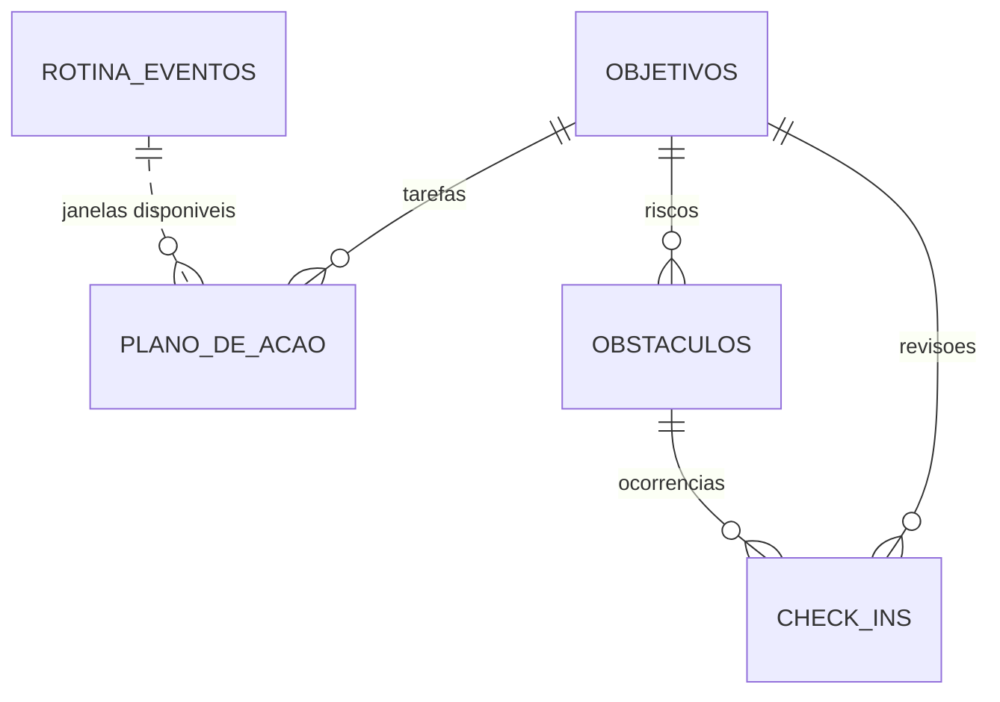
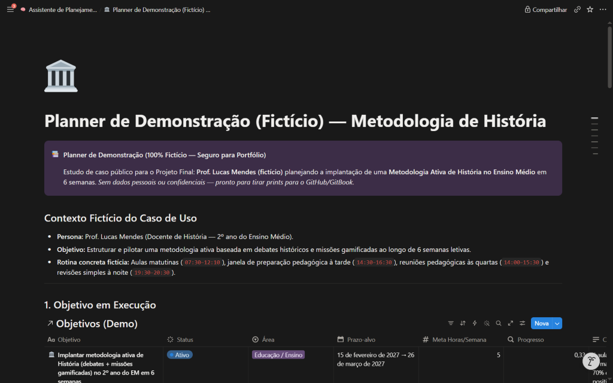
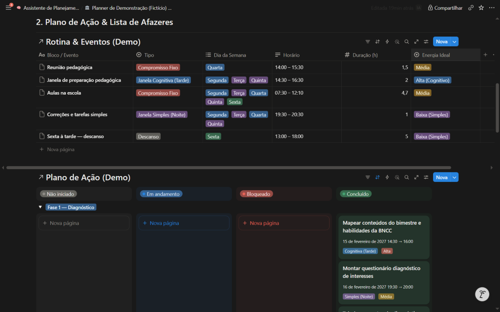
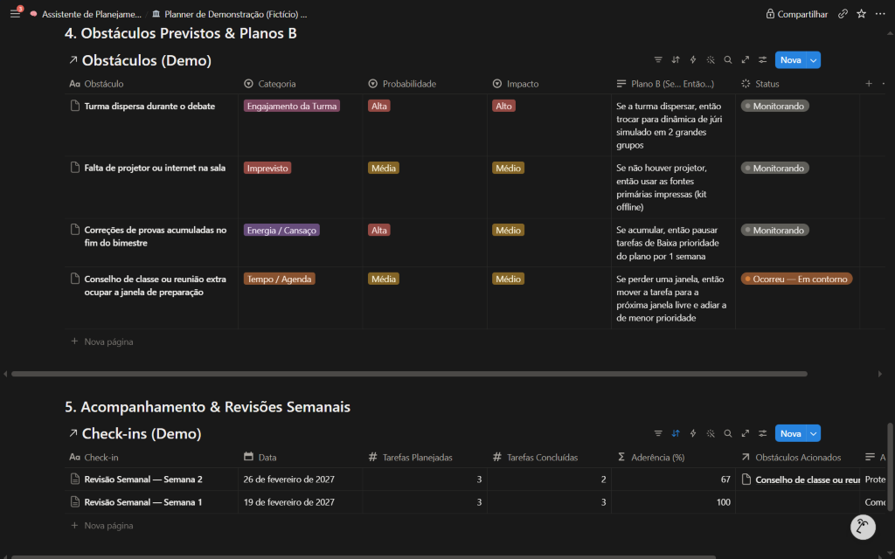
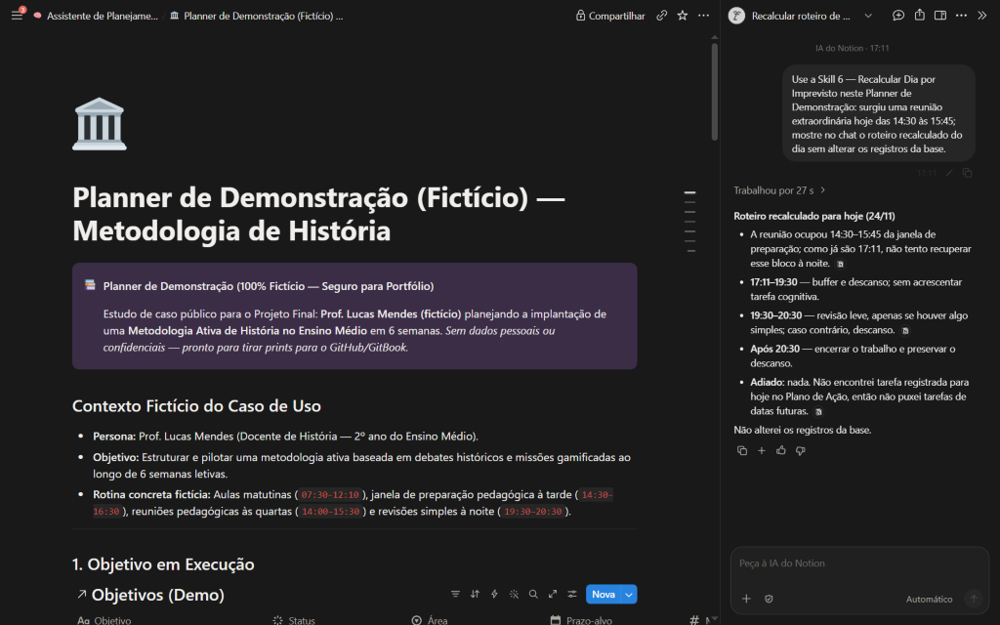

# Assistente de Planejamento com IA no Notion

Projeto final desenvolvido para a trilha de criação de assistentes com IA. A ideia foi montar um Planner funcional no Notion acompanhado de um conjunto de habilidades (Skills) reutilizáveis para tirar objetivos do papel sem ignorar a rotina real do dia a dia.

## O problema e o que tentei fazer diferente

Quando a gente pede um cronograma de estudos ou trabalho para uma IA comum, ela quase sempre devolve um plano bonito no papel, mas impossível de manter. Normalmente ela ignora horários fixos de aula ou trabalho, joga tarefas difíceis para horários em que já estamos cansados e não prevê o que fazer quando surge um imprevisto no meio da tarde.

Para resolver isso, estruturei o assistente em cima de quatro pontos práticos:

- **Capacidade real antes de criar metas:** antes de distribuir tarefas na semana, a IA consulta uma base com os compromissos fixos e deixa cerca de 15% de margem livre.
- **Divisão por nível de energia:** separei as janelas e as tarefas entre turno de maior foco (tarde, para conteúdo pesado e criação) e turno de energia mais baixa (noite, apenas para revisão rápida, resumos ou organização).
- **Planos B diretos:** cada obstáculo cadastrado já tem um sinal de alerta claro e uma ação simples no formato "Se acontecer X, faço Y", evitando travar quando algo sai do previsto.
- **Habilidade extra para imprevistos do dia:** além das 5 habilidades propostas na trilha, criei uma 6ª skill focada em recalcular apenas o restante do dia quando aparece uma reunião ou atraso inesperado, sem invadir o horário de descanso.

## Ferramentas e recursos escolhidos

Optei por concentrar tudo dentro do próprio **Notion** junto com a **IA do Notion**, complementando a visualização de horários com o **Google Agenda / Notion Calendar**:

- **Bases de dados com Relation:** conectam o objetivo diretamente às tarefas, aos obstáculos e às revisões semanais, permitindo que a IA leia todo o contexto sem precisar copiar e colar listas a cada conversa.
- **Rollup e Fórmulas:** usados para calcular automaticamente o progresso do objetivo (com base nas tarefas concluídas) e a taxa de aderência (%) nas revisões semanais.
- **Propriedade de Data com horário inicial e final:** permite trabalhar com blocos de tempo definidos (*time-blocking*), facilitando bater o olho no que precisa ser feito em cada janela do dia.
- **Vistas vinculadas na página principal:** deixam o objetivo ativo, o quadro Kanban de tarefas, a rotina fixa, os obstáculos e os check-ins visíveis em um painel único, sem precisar entrar em cada tabela separadamente.
- **Skills nativas da IA do Notion:** transformam cada etapa do planejamento em uma instrução salva no workspace. Além de padronizar as respostas, isso ajuda bastante no plano gratuito do Notion, já que um único pedido direto aciona todo o passo a passo sem gastar várias mensagens curtas.
- **Integração com Google Agenda (via Notion Calendar):** ajuda a cruzar eventos externos com hora marcada com os blocos planejados no Notion.

## Estrutura do Planner

O painel foi montado com **5 bases de dados** trabalhando juntas:

1. **Objetivos:** guarda a meta principal, área (estudo, ensino, carreira etc.), status, prazo-alvo, horas disponíveis por semana, critério de sucesso e a barra de `Progresso` (calculada via *Rollup* das tarefas concluídas).
2. **Plano de Ação:** reúne os afazeres quebrados por marco/fase, prioridade, status, esforço estimado em minutos, `Bloco de Tempo` (data com início e fim), `Tipo de Energia` (`Cognitiva (Tarde)` ou `Simples (Noite)`) e uma fórmula simples (`Feito`) para alimentar o progresso.
3. **Rotina & Eventos:** mapeia os compromissos fixos da semana, horários de descanso e as janelas livres de cada dia com o nível de energia correspondente.
4. **Obstáculos:** lista os riscos mais prováveis do plano com categoria, probabilidade, impacto, gatilho (sinal de alerta), prevenção e o `Plano B (Se... Então...)`.
5. **Check-ins:** registra o acompanhamento semanal ou diário, comparando `Tarefas Planejadas` e `Tarefas Concluídas` na fórmula de `Aderência (%)`, além de guardar vitórias do período, obstáculos acionados e ajustes para a próxima semana.

## Habilidades (Skills) e instruções aplicadas

Ao escrever as instruções de cada habilidade, tomei cuidado para não criar prompts gigantes cheios de regras contraditórias (evitando que o modelo se perca no meio do texto ou ative a instrução na hora errada). Cada skill tem um gatilho claro dizendo quando deve ser usada, quando **não** deve ser usada, quais bases precisa ler e o formato esperado da resposta.

Os textos completos aplicados no Notion estão na pasta [`skills/`](./skills):

| Skill | Nome | Descrição e função no método | Arquivo com as instruções |
| :---: | :--- | :--- | :--- |
| **1** | Esclarecer e Registrar Objetivo | Pega uma ideia ainda aberta, faz até 4 perguntas diretas para fechar prazo e critérios observáveis, valida se cabe nas horas da semana e cria o registro em `Objetivos`. | [`skill-01-esclarecer-objetivo.md`](./skills/skill-01-esclarecer-objetivo.md) |
| **2** | Gerar Plano de Ação | Lê o objetivo registrado, reserva ~15% do tempo como margem, divide em 3 a 5 fases e gera tarefas de 25 a 180 minutos já separadas entre energia cognitiva e simples. | [`skill-02-gerar-plano-de-acao.md`](./skills/skill-02-gerar-plano-de-acao.md) |
| **3** | Adaptar Plano à Rotina | Cruza as tarefas com a base `Rotina & Eventos` e compromissos da semana, encaixando tarefas pesadas à tarde e tarefas simples à noite em blocos de horário definidos. | [`skill-03-adaptar-plano-a-rotina.md`](./skills/skill-03-adaptar-plano-a-rotina.md) |
| **4** | Antecipar Obstáculos e Planos B | Analisa pontos críticos do cronograma (dias cheios, entregas acumuladas, recursos) e cadastra de 4 a 6 obstáculos com gatilho e Plano B prático. | [`skill-04-antecipar-obstaculos.md`](./skills/skill-04-antecipar-obstaculos.md) |
| **5** | Revisar Progresso e Replanejar | Fecha o ciclo semanal calculando a aderência das tarefas, relaciona eventuais atrasos aos obstáculos mapeados e reorganiza a semana seguinte sem bola de neve. | [`skill-05-revisar-progresso.md`](./skills/skill-05-revisar-progresso.md) |
| **6** | Recalcular Dia por Imprevisto *(Extra)* | Usada quando surge um compromisso inesperado no mesmo dia: mantém só o essencial ou reduz para uma versão mínima, adiando o resto sem cortar o descanso noturno. | [`skill-06-recalcular-dia.md`](./skills/skill-06-recalcular-dia.md) |

## Demonstração prática (estudo de caso fictício)

Para documentar o funcionamento sem expor minha rotina pessoal, montei um Planner separado com dados fictícios simulando a rotina do **Prof. Lucas Mendes**, professor de História do 2º ano do Ensino Médio.

### Cenário inicial
- **Ideia inicial:** aplicar uma metodologia ativa com debates históricos e missões em grupo durante o bimestre sem acumular trabalho extra de madrugada.
- **Rotina fixa cadastrada:** aulas de segunda a sexta (`07:30-12:10`), reunião pedagógica às quartas (`14:00-15:30`), janelas de preparação cognitiva nas tardes de segunda, terça e quinta (`14:30-16:30`), tarefas simples à noite (`19:30-20:30`) e sexta à tarde livre para descanso.

### Como cada etapa estruturou o plano

1. **Objetivo registrado (Skill 1):** ficou definido *"Implantar metodologia ativa de História (debates + missões gamificadas) no 2º ano do EM em 6 semanas"* (`15/02/2027` a `26/03/2027`), com meta de 5h semanais e critério de pronto baseado na aplicação de 4 aulas-piloto em 2 turmas e pelo menos 70% de retorno positivo dos alunos.
2. **Plano de ação gerado (Skill 2):** o objetivo virou 4 fases (*Diagnóstico*, *Planejamento das Aulas*, *Aplicação Piloto* e *Avaliação e Ajustes*) somando 15 tarefas dentro do limite de horas disponíveis.
3. **Encaixe na rotina (Skill 3):** atividades que exigem mais cabeça (como montar a sequência didática, criar a rubrica de debates e selecionar fontes primárias da Inconfidência Mineira) entraram nas tardes de segunda, terça e quinta (`14:30-16:30`). Tarefas operacionais curtas (montar formulário, tabular respostas, imprimir material e preencher diário de bordo) ficaram nos blocos noturnos (`19:30-20:15`).
4. **Obstáculos previstos (Skill 4):** foram mapeados 4 riscos reais da sala de aula, como turma dispersa no debate (Plano B: converter a aula em júri simulado com dois grandes grupos), falta de projetor (Plano B: kit impresso offline) e reuniões extras na janela de preparação.
5. **Acompanhamento semanal (Skill 5):** na Semana 1 a aderência foi de 100% (3/3 tarefas). Já na Semana 2 houve um conselho de classe extra na quinta-feira que derrubou a aderência para 67% (2/3 tarefas), acionando o Plano B de mover a seleção de fontes primárias para a segunda seguinte.
6. **Teste ao vivo de imprevisto na IA do Notion (Skill 6):** simulei no chat da IA do Notion uma reunião extraordinária das `14:30` às `15:45`. Seguindo as regras da Skill 6 e da tabela de rotina, a IA evitou empurrar tarefa cognitiva pesada para a noite, separou o fim da tarde como buffer, manteve apenas a janela leve de `19:30-20:30` se houvesse revisão simples e encerrou o expediente às `20:30` para preservar o descanso.

### Prints do Planner de exemplo e da Skill funcionando

**1. Visão geral do Planner e objetivo em andamento**

**2. Grade de rotina semanal e quadro do Plano de Ação**

**3. Obstáculos mapeados (com Plano B) e histórico de Check-ins**

**4. Skill 6 respondendo na IA do Notion diante de um imprevisto**

